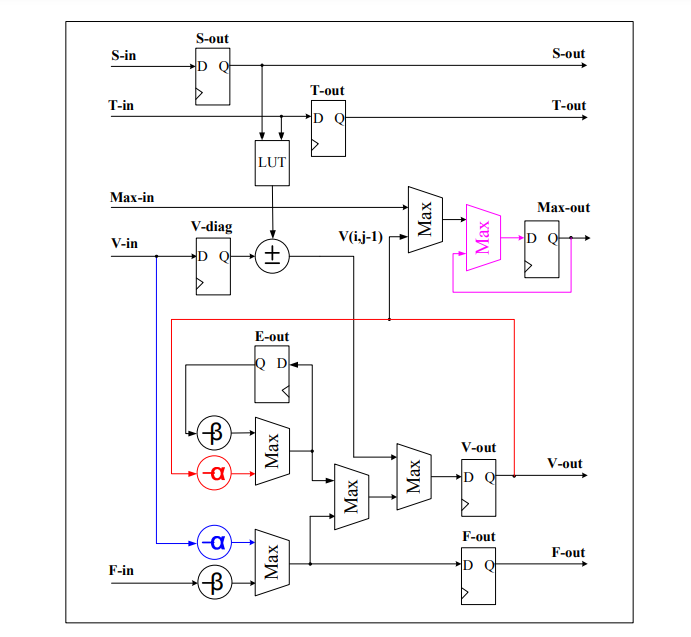
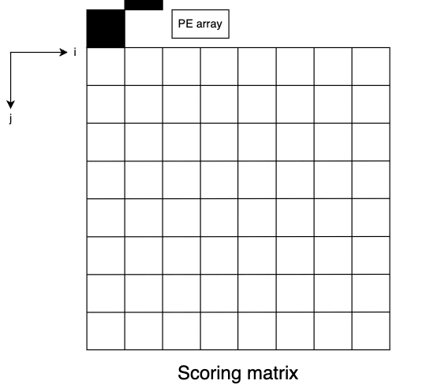

# Smith Waterman Genome Alignment
Software (Python golden model) and hardware (Verilog RTL) implementation of the
Smith-Waterman local alignment algorithm with **affine gap penalty and traceback**.

> The Smith–Waterman algorithm performs local sequence alignment; that is, for determining similar regions between two strings of nucleic acid sequences or protein sequences. Instead of looking at the entire sequence, the Smith–Waterman algorithm compares segments of all possible lengths and optimizes the similarity measure.
> please check out wiki for more information: https://en.wikipedia.org/wiki/Smith%E2%80%93Waterman_algorithm

## Scoring
| | |
|---|---|
| match / mismatch | +8 / -5 |
| gap open / extend | -7 / -3 (a gap of length n costs 7 + 3(n-1)) |

```
E(i,j) = max(E(i,j-1) - 3, H(i,j-1) - 7)          gap in S  (INS)
F(i,j) = max(F(i-1,j) - 3, H(i-1,j) - 7)          gap in T  (DEL)
H(i,j) = max(0, H(i-1,j-1) + s(S[i],T[j]), E(i,j), F(i,j))
boundary: H = 0, E = F = -inf
```
Tie-break rules (identical in Python and RTL, so the traceback can be checked op by op):
* best cell: highest score, then smallest `i`, then smallest `j`
* source of H: `H == 0` → stop, else DIAG > UP (F) > LEFT (E)
* E / F: extend only if strictly better than opening a new gap

## Software
* `SW.py` – golden model (scoring + traceback), bit-exact with the RTL
  `python3 SW.py` aligns the demo sequences, `python3 SW.py --s a.dat --t b.dat` aligns pattern files
* `gen_pattern.py` – generates `testbench/pattern/caseNN_{s,t,golden}.dat`
  (`--length L`, `--random N` for stress tests, `--legacy s.dat t.dat` to include your own pairs)

## Hardware
One parameterized design, `verilog/SW.v`:

| parameter | meaning |
|---|---|
| `L` | sequence length (power of 2, default 256) |
| `NUM_PE` | number of PEs; `NUM_PE = L` → one pass, `NUM_PE < L` → `L/NUM_PE` passes |

* **NUM_PE = 256** (former `SW.v`) – one PE per row of S, T streams through the linear systolic array.
* **NUM_PE = 128** (former `SW_v2.v`) – the array is used twice; the bottom row of pass 0
  (H, F and T of PE127) goes through a `L - NUM_PE` = 128-deep buffer back into PE0 for pass 1.




### Traceback
* Every PE writes a 4-bit pointer `{hsrc[1:0], e_ext, f_ext}` per cell into its own pointer bank
  (depth `L/NUM_PE * L`, address = pass·L + column). `e_ext / f_ext` are needed to trace affine gaps correctly.
* The best `(score, i, j)` is reduced along the PE chain (same tie-break as above).
* After the last cell, a traceback FSM starts at the best cell, reads bank `i % NUM_PE`, address `(i / NUM_PE)·L + j`,
  and emits **one op per cycle** until it reaches a cell with `H = 0`.

### Interface
| port | dir | description |
|---|---|---|
| `valid`, `data_s[1:0]`, `data_t[1:0]` | in | `S[k]`, `T[k]` for k = 0..L-1 on L consecutive cycles (A=0 C=1 G=2 T=3) |
| `aln_valid`, `aln_op[1:0]` | out | alignment ops from the alignment **end back to its start**: 0 MATCH, 1 MISMATCH, 2 INS (gap in S), 3 DEL (gap in T) |
| `finish` | out | 1-cycle pulse when traceback is done |
| `max` | out | best score (13 bit, max 8·256 = 2048) |
| `end_i`, `end_j` / `start_i`, `start_j` | out | indices of the last / first aligned pair |
| `aln_len` | out | number of ops |

Latency after the last input: `(L/NUM_PE - 1)·L + NUM_PE + 3 + #ops` cycles (NUM_PE 256: 259 + ops, NUM_PE 128: 387 + ops).
The design returns to idle after `finish` and accepts the next pair without reset.

### Simulation
```
cd testbench
source license.sh
vcs tb_SW.v +define+RTL       -full64 -R -debug_access+all +v2k +notimingcheck   # NUM_PE = 256
vcs tb_SW.v +define+RTL+SW_v2 -full64 -R -debug_access+all +v2k +notimingcheck   # NUM_PE = 128
# or with Icarus Verilog:
sh run_iverilog.sh            # both configurations
sh run_iverilog.sh stress     # + 60 random pairs each for L = 16..64, NUM_PE = 1..64
```
The testbench runs all cases back-to-back and checks score, end/start position, length and every traceback op.

## Fixes compared to the previous version
The old RTL passed its testbench only because `golden1.dat` / `golden2.dat` were produced by the same buggy
hardware (590 / 586, correct scores are **593 / 592**). Problems found:
1. `finish`/`max` were latched one cycle too early: the best cell (PE245, column 255) had not yet propagated through
   the max chain to PE255 → 590 instead of 593.
2. `H` was not clamped at 0, so it was not a local alignment (negative cells; e.g. 637 instead of 638 on another pattern).
3. E / F boundaries were initialized to 0 instead of -∞.
4. `9'd256` overflows (truncated to 0 by some simulators), which breaks the PE `stop` condition.
5. 12-bit signed scores overflow for 256 matches (2048).
6. SW_v2: all cells of pass 0 were right, but the second pass is wrong from its very first column (row 129, column 0: 5 instead of 8)
   because the PEs were reused without resetting the left / diagonal registers left over from the previous row → 586 instead of 592.
7. `SW.py` used a linear gap model with different scores, so it could not produce the golden data.

Synthesis results are not included in this repository.
