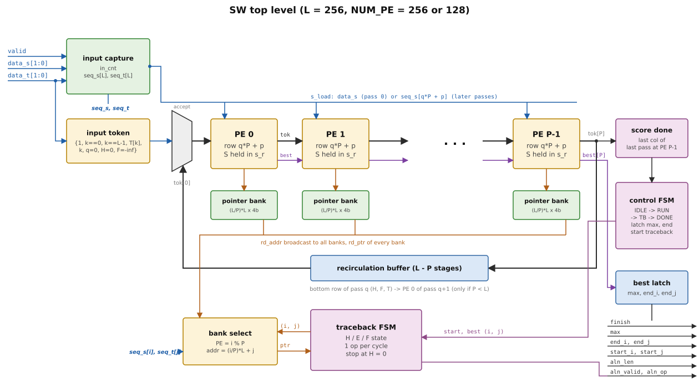
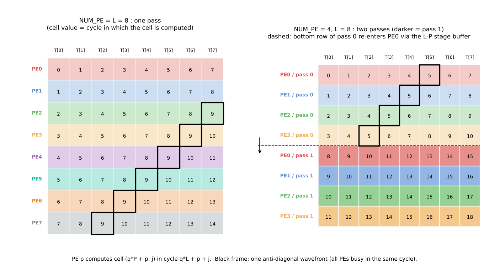
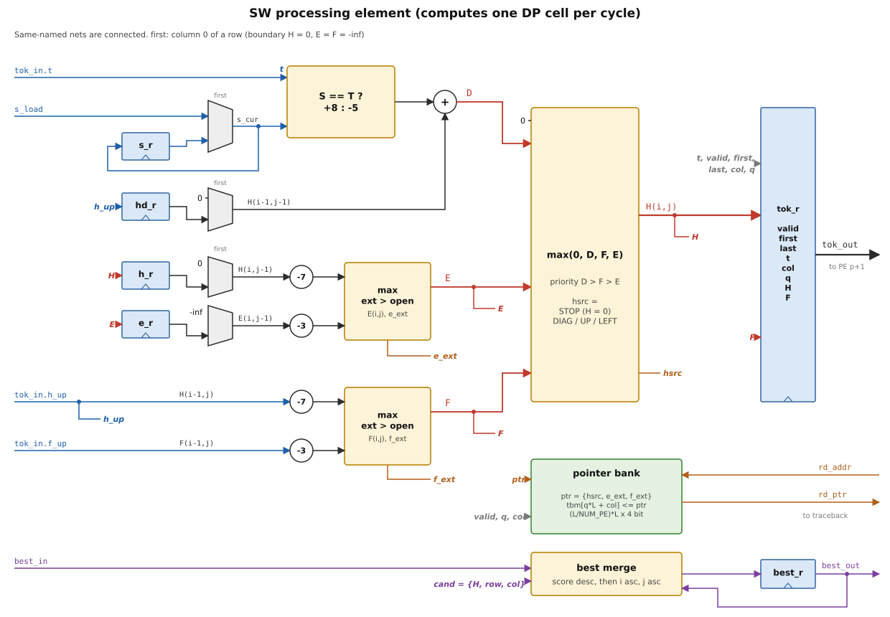
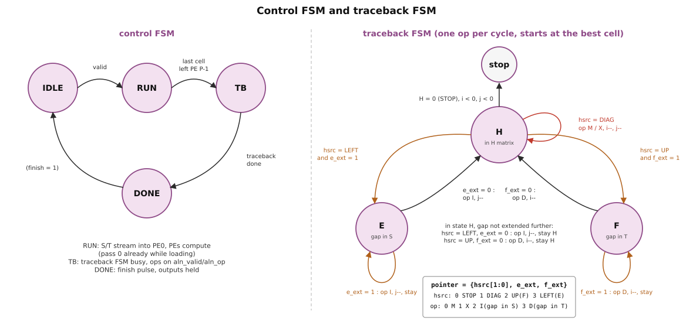
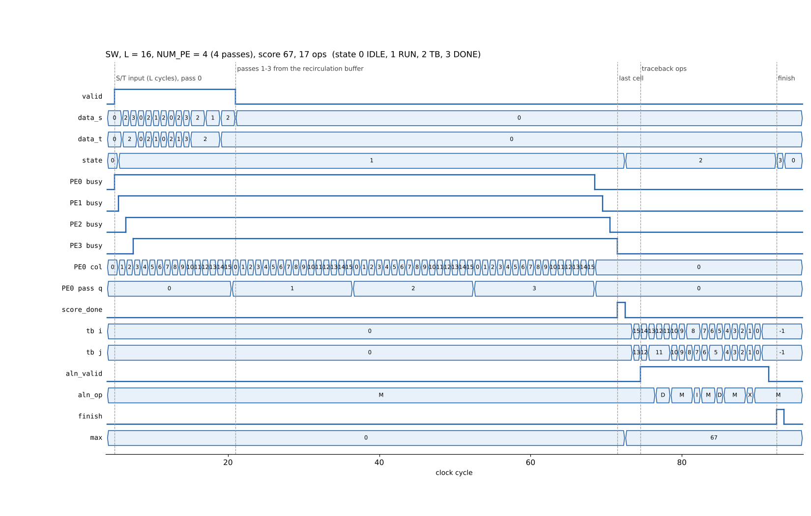
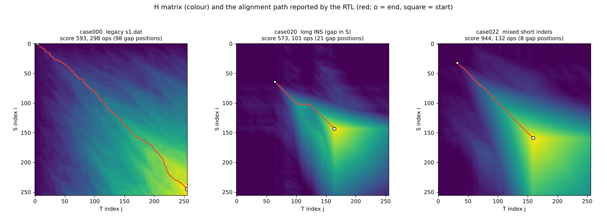
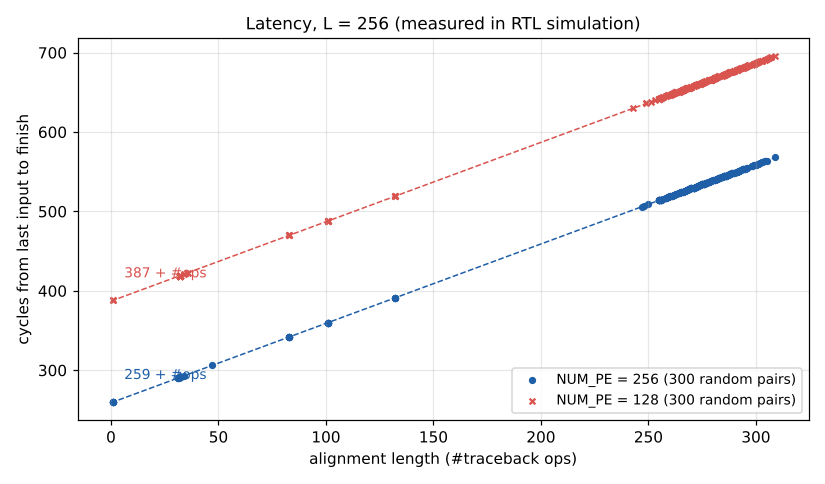

# Smith-Waterman 硬體加速器設計報告

> 具 affine gap 與硬體 traceback 的 Smith-Waterman 區域比對加速器（Verilog RTL）
> 參數化 systolic array：`NUM_PE = 256`（單趟）或 `NUM_PE = 128`（兩趟 + recirculation buffer）

## 目錄
1. [規格摘要](#1-規格摘要)
2. [演算法](#2-演算法)
3. [硬體架構](#3-硬體架構)
4. [驗證方法與結果](#4-驗證方法與結果)
5. [合成估計](#5-合成估計)
6. [使用方式與檔案結構](#6-使用方式與檔案結構)

---

## 1. 規格摘要

| 項目 | 規格 |
|---|---|
| 功能 | 兩條 DNA 序列 S、T 的區域比對（local alignment），輸出最高分、比對起點與終點，以及完整的比對路徑 |
| 序列長度 | `L`（預設 256），S 與 T 等長，每個鹼基 2 bit（A=0, C=1, G=2, T=3） |
| 計分 | match +8、mismatch −5、gap open −7、gap extend −3（長度 n 的 gap 扣 7 + 3(n−1)） |
| 架構 | 線性 systolic array，`NUM_PE` 個 PE（須整除 L）；`NUM_PE < L` 時陣列重複使用 `L/NUM_PE` 趟 |
| 預設配置 | `NUM_PE = 256`（1 趟），`NUM_PE = 128`（2 趟，`+define+SW_v2`） |
| 分數位寬 | 13 bit signed（`DW = ⌈log2(8L+1)⌉ + 1`，最高分 8·256 = 2048） |
| Traceback | 每格 4 bit pointer，硬體 FSM 每個 cycle 輸出一個比對運算（MATCH / MISMATCH / INS / DEL） |
| 延遲 | 最後一筆輸入之後 `(L/NUM_PE − 1)·L + NUM_PE + 3 + 比對長度` 個 cycle 拉起 `finish`（256 PE：259 + ops；128 PE：387 + ops） |
| 記憶體 | pointer 記憶體共 4·L² bit（262,144 bit），平均分給各 PE；序列儲存 2·2L bit |
| 輸入協定 | `valid` 連續拉高 L 個 cycle，同時送 `S[k]`、`T[k]` |
| 重置 | 非同步、active-high `reset`；`finish` 之後自動回到 IDLE，可直接送下一組，不需 reset |


### 1.1 適用範圍：single-tile accelerator

本設計是 **single-tile** 的加速器：一次只處理一個 tile，也就是長度同為 `L` 的 query `S` 與 reference `T`，算出整個 L×L 矩陣並輸出這個 tile 的完整區域比對。**`L` 就是 tile 大小**（編譯時的 parameter，預設 256），使用者可依需求自行選擇。代價隨 `L` 成長如下：

| `L`（tile 大小） | 分數位寬 | pointer 記憶體（4·L² bit） | 相對 L = 256 |
|---:|---:|---:|---:|
| 64 | 11 bit | 16,384 bit（2 KiB） | 0.0625× |
| 128 | 12 bit | 65,536 bit（8 KiB） | 0.25× |
| 256 | 13 bit | 262,144 bit（32 KiB） | 1× |
| 512 | 14 bit | 1,048,576 bit（128 KiB） | 4× |
| 1024 | 15 bit | 4,194,304 bit（512 KiB） | 16× |
| 2048 | 16 bit | 16,777,216 bit（2 MiB） | 64× |

* pointer 記憶體與 **L²** 成正比，`L` 加倍則記憶體變 4 倍，是面積暴增的主因；`NUM_PE`（須整除 `L`）則是在面積與延遲之間取捨。
* 實際模擬驗證的範圍只有 `L` = 4 … 256；更大的 `L` 由同一組 parameter 推得，尚未驗證。
* `S`、`T` 必須剛好各 `L` 個鹼基；較短的序列需自行補齊，不支援兩者不等長。

實際應用中 S 與 T 通常長得很像，比對結果會集中在主對角線附近，因此較長的序列預期的做法是沿對角線切成多個 tile，再把各 tile 的結果串接起來。**本專案只實作單一 tile**；tile 與 tile 之間的串接**沒有處理**，包括相鄰 tile 之間邊界狀態（H / E / F）的傳遞、各 tile 最高分的合併，以及 traceback 路徑的接合，都需要在本模組之外完成。

---

## 2. 演算法

### 2.1 Smith-Waterman 與 affine gap（Gotoh）

對 S[0..L−1]、T[0..L−1]，以 0-based 的 cell (i, j) 表示 S[i] 與 T[j] 對齊。使用三個矩陣：

```
E(i,j) = max( E(i,j-1) - 3 ,  H(i,j-1) - 7 )                     gap 在 S 中（INS，往左走）
F(i,j) = max( F(i-1,j) - 3 ,  H(i-1,j) - 7 )                     gap 在 T 中（DEL，往上走）
H(i,j) = max( 0 ,  H(i-1,j-1) + s(S[i],T[j]) ,  E(i,j) ,  F(i,j) )
s(a,b) = +8 (a = b) / -5 (a ≠ b)
邊界：H(-1,·) = H(·,-1) = 0，E = F = -∞
```

* `max(0, …)` 讓分數不會變成負的，比對可以在任何位置重新開始，這就是 local alignment。
* E 與 F 分開記錄「gap 開啟」與「gap 延伸」，所以連續的 gap 只在第一格扣 7，之後每格扣 3。

### 2.2 Traceback

除了分數之外，每格另外記一個 4 bit pointer：

| bit | 名稱 | 意義 |
|---|---|---|
| [3:2] | `hsrc` | H(i,j) 的來源：0 STOP（H = 0）、1 DIAG、2 UP（= F）、3 LEFT（= E） |
| [1] | `e_ext` | E(i,j) 來自 E(i,j−1)（延伸），否則來自 H(i,j−1)（開啟） |
| [0] | `f_ext` | F(i,j) 來自 F(i−1,j)（延伸），否則來自 H(i−1,j)（開啟） |

affine gap 的回溯必須知道自己目前在 H、E 還是 F 矩陣，所以 traceback 是一個三狀態的狀態機：

* **H 狀態**：依 `hsrc` 決定。DIAG 輸出 MATCH/MISMATCH 並走到 (i−1, j−1)；UP 等同進入 F；LEFT 等同進入 E；STOP 或走出矩陣就結束。
* **F 狀態**：輸出 DEL，i−1；如果這格的 `f_ext = 1` 就留在 F，否則回到 H。
* **E 狀態**：輸出 INS，j−1；如果這格的 `e_ext = 1` 就留在 E，否則回到 H。

比對運算由終點往起點輸出；最後停下來的 cell 是 (i, j) 時，比對起點就是 (i+1, j+1)。

### 2.3 同分時的決定規則

同一組輸入可能有多個最佳解。為了讓硬體與 golden model 能逐個運算比對，規則固定如下：

1. **最佳格**：分數最高者；同分取 i 最小，再同分取 j 最小。
2. **H 的來源**：H = 0 時一律 STOP；否則優先序 DIAG > UP (F) > LEFT (E)。
3. **gap 延伸**：只有在「延伸」嚴格大於「開啟」時才算延伸（同分視為開啟）。

### 2.4 Golden model

`SW.py` 是逐位元對應硬體的 Python 模型（分數、pointer、同分規則、traceback 完全一致）。它的正確性另外用兩種方法獨立檢查（`tools/validate_model.py`）：

* **與 Biopython 的 `PairwiseAligner` 比對**（local mode，match 8、mismatch −5、`open_gap_score` −7、`extend_gap_score` −3）：3,000 組隨機與突變序列（長度 1–256，含不等長）分數全部一致。
* **重新計分**：每個 traceback 結果都依運算序列重算分數，必須等於回報的最高分。

---

## 3. 硬體架構

### 3.1 頂層



| 方塊 | 功能 |
|---|---|
| input capture | `in_cnt` 計數，把 S、T 存進 `seq_s[L]`、`seq_t[L]`（給後續趟數的 S 與 traceback 使用） |
| input token | 把 `T[k]` 包成 token 送進 PE0：`{valid, first = (k==0), last = (k==L−1), T[k], col = k, q = 0, H_up = 0, F_up = −∞}` |
| PE array | `NUM_PE` 個 PE 串成一條鏈，token 每個 cycle 往下傳一個 PE |
| recirculation buffer | 只在 `NUM_PE < L` 時存在：PE P−1 輸出的 token（帶著第 qP+P−1 列的 H、F 與 T）經過 L−P 級暫存器回到 PE0，成為下一趟的「上一列」 |
| pointer bank | 每個 PE 一個，深度 (L/P)·L，寬 4 bit，位址 = q·L + col |
| score done | PE P−1 輸出最後一趟、最後一欄的 token 時，最佳格已經確定 |
| traceback FSM + bank select | 由最佳格出發，讀第 `i % P` 個 bank 的位址 `(i / P)·L + j`，每個 cycle 輸出一個運算 |
| control FSM | IDLE → RUN → TB → DONE |

### 3.2 資料流與排程



* PE p 負責第 `q·P + p` 列（第 q 趟），S 存在 PE 內部的 `s_r`，T 以 token 的形式每個 cycle 流過一個 PE。
* **PE p 在第 `q·L + p + j` 個 cycle 計算 cell (q·P + p, j)**（以第一筆輸入為 cycle 0）。同一個 cycle 內所有 PE 計算的是同一條反對角線，彼此沒有資料相依。
* 每個 cell 需要的三個鄰居都在一個 cycle 之內可取得：
  * 左 (i, j−1)：PE 自己上一個 cycle 的結果 `h_r`、`e_r`
  * 上 (i−1, j)：上一個 PE 剛送來的 token（`H_up`、`F_up`）
  * 左上 (i−1, j−1)：上一個 token 的 `H_up`，延遲一個 cycle 存在 `hd_r`
* **多趟排程**：第 q 趟的 PE P−1 在 cycle `q·L + P − 1 + j` 算出第 j 欄並在下一個 cycle 送出；第 q+1 趟的 PE0 要在 cycle `(q+1)·L + j` 用到它，時間差剛好是 `L − P` 個 cycle，所以 recirculation buffer 的深度就是 L − P（256/128 時為 128 級）。PE 在第 q 趟算完最後一欄的下一個 cycle，正好開始第 q+1 趟，陣列沒有閒置。
* 第 0 趟的 S[p] 在 PE p 開始的那一個 cycle 正好出現在 `data_s` 上（廣播），所以第 0 趟不需要等序列存完。後續趟數的 S 從 `seq_s[q·P + p]` 讀取。

### 3.3 Token 格式

| 欄位 | 寬度 | 內容 |
|---|---|---|
| valid | 1 | 這個 cycle 有一個 cell 要算 |
| first / last | 1 / 1 | 第 0 欄 / 第 L−1 欄 |
| t | 2 | T[col] |
| col | 8 | 欄位 j |
| q | 1–3 | 趟數 |
| H_up | 13 | 上一列同一欄的 H |
| F_up | 13 | 上一列同一欄的 F |

### 3.4 PE（processing element）



* **match 單元**：比較 `s_cur` 與 `t`，得到 +8 或 −5；加上 `H(i−1, j−1)` 得到 D。
* **E 單元**：`H(i,j−1) − 7` 與 `E(i,j−1) − 3` 比大小，輸出 E 與 `e_ext`（延伸嚴格較大時為 1）。
* **F 單元**：`H_up − 7` 與 `F_up − 3` 比大小，輸出 F 與 `f_ext`。
* **H 單元**：`max(0, D, F, E)`，依 D > F > E 的優先序決定 `hsrc`。
* **列首邊界**：token 的 `first = 1`（第 0 欄）時，左邊與左上的值被換成 H = 0、E = −∞，S 由 `s_load` 載入。所以同一個 PE 換到下一趟時不會帶著上一列的狀態。
* **位寬**：因為 H ≥ 0，E 與 F 永遠 ≥ −7，用 −16 代表 −∞ 就不會溢位，13 bit signed 足以涵蓋 −16 到 2048。
* **best merge**：每個 PE 維護 `best_r = {score, i, j}`，每個 cycle 與上一個 PE 的 `best` 以及自己的新 cell 合併（分數大者；同分取 i、j 小者）。這個合併滿足交換律與結合律，最後在 PE P−1 得到整個矩陣的最佳格。
* **pointer bank**：每算一格，就在 `q·L + col` 寫入 `{hsrc, e_ext, f_ext}`；traceback 時用 `rd_addr` 讀取。

### 3.5 控制與 traceback FSM



* **RUN → TB**：PE P−1 輸出「最後一趟、最後一欄」的 token（`score_done`）時，`best[P]` 已經包含所有 cell，把它鎖存成 `max`、`end_i`、`end_j`，並啟動 traceback。
* **TB**：traceback FSM 由 (end_i, end_j) 出發，每個 cycle 讀一次 pointer 與 `seq_s[i]`、`seq_t[j]`（判斷 MATCH / MISMATCH），在 `aln_valid` / `aln_op` 上輸出一個運算。
* **DONE**：`finish` 拉高一個 cycle，同時給出 `start_i`、`start_j` 與 `aln_len`；接著回到 IDLE。

### 3.6 介面

| port | 方向 | 寬度 | 說明 |
|---|---|---|---|
| `clk`, `reset` | in | 1 | 時脈；非同步 active-high 重置 |
| `valid` | in | 1 | 連續 L 個 cycle 為 1 |
| `data_s`, `data_t` | in | 2 | 第 k 個 valid cycle 送 S[k]、T[k] |
| `aln_valid` | out | 1 | `aln_op` 有效 |
| `aln_op` | out | 2 | 0 MATCH、1 MISMATCH、2 INS（gap 在 S）、3 DEL（gap 在 T），由比對終點往起點輸出 |
| `finish` | out | 1 | 一個 cycle 的脈衝，表示這組結果完成 |
| `max` | out | 13 | 最高分 |
| `end_i`, `end_j` | out | 8 | 比對最後一對鹼基的位置 |
| `start_i`, `start_j` | out | 8 | 比對第一對鹼基的位置 |
| `aln_len` | out | 10 | 運算個數 |

分數為 0（完全沒有正分的比對）時，`aln_len = 0`，end = (0, 0)，start = (1, 1)。

---

## 4. 驗證方法與結果

### 4.1 驗證流程

```
gen_pattern.py ──► caseNNN_s.dat / caseNNN_t.dat / caseNNN_golden.dat      (golden 由 SW.py 產生)
                          │
tb_SW.v ──────────────────┴──► 逐組送入 RTL（不 reset、背靠背），比對：
                                 score、end_i/j、start_i/j、aln_len、以及每一個 aln_op
                               ──► tb_result.txt（每組結果與延遲）、tb_ops.txt（硬體輸出的運算）
run_regression.py ─► 不同 L / NUM_PE / 測資組合的完整 regression ─► regression_summary.md
```

testbench 另外包含：

* **reset 恢復測試**：在 scoring 進行到一半時拉 reset，確認之後沒有任何輸出，再重新跑一次 case000，結果必須正確。
* **每組 watchdog**：16L + 64 個 cycle 內沒有 `finish` 就判定失敗。
* **完整性檢查**：regression 會確認每個配置的測資全部跑完。

### 4.2 測資

固定的 regression set（`testbench/pattern`，28 組）分成三類：

* **原始測資**：case000–001
* **典型配對**：完全相同、完全不配、無關的隨機序列、5% / 20% 突變、長 gap、低複雜度序列等
* **directed 測資**：S 只用 {A, C}、T 只用 {G, T} 當背景，兩者幾乎不會隨機匹配，再把 motif 種在指定位置，就能精確控制最佳解：
  * motif 放在矩陣的四個角落或中間
  * 只有一個相同鹼基
  * 同分（在 S 或 T 中出現兩次、2×2 次）
  * 長度 21 的 INS / DEL
  * 混合短 indel
  * 每 3 個鹼基有 1 個 mismatch
  * 跨過 3 個 mismatch 的橋接
  * 週期序列

| case | 測資 | 分數 | 終點 (i,j) | 起點 (i,j) | 運算數 | 256 PE | 128 PE | 64 PE | 32 PE |
|---|---|---|---|---|---|---|---|---|---|
| 000 | sample s1.dat | 593 | (245,255) | (0,4) | 298 | ✓ | ✓ | ✓ | ✓ |
| 001 | sample s2.dat | 592 | (255,238) | (0,1) | 289 | ✓ | ✓ | ✓ | ✓ |
| 002 | identical | 2048 | (255,255) | (0,0) | 256 | ✓ | ✓ | ✓ | ✓ |
| 003 | all mismatch | 0 | (0,0) | (1,1) | 0 | ✓ | ✓ | ✓ | ✓ |
| 004 | unrelated random | 600 | (254,223) | (6,2) | 283 | ✓ | ✓ | ✓ | ✓ |
| 005 | 5% subst + small indels | 1720 | (250,255) | (1,1) | 258 | ✓ | ✓ | ✓ | ✓ |
| 006 | long gaps | 1878 | (253,255) | (0,0) | 266 | ✓ | ✓ | ✓ | ✓ |
| 007 | local region | 979 | (255,207) | (33,2) | 244 | ✓ | ✓ | ✓ | ✓ |
| 008 | 20% subst + indels | 1156 | (247,255) | (0,0) | 269 | ✓ | ✓ | ✓ | ✓ |
| 009 | shifted copy | 2024 | (252,255) | (0,3) | 253 | ✓ | ✓ | ✓ | ✓ |
| 010 | low complexity | 1629 | (250,255) | (0,0) | 264 | ✓ | ✓ | ✓ | ✓ |
| 011 | motif in the middle | 256 | (95,98) | (64,67) | 32 | ✓ | ✓ | ✓ | ✓ |
| 012 | motif at the start (0,0) | 256 | (31,31) | (0,0) | 32 | ✓ | ✓ | ✓ | ✓ |
| 013 | motif at the end (L-1,L-1) | 256 | (255,255) | (224,224) | 32 | ✓ | ✓ | ✓ | ✓ |
| 014 | motif S start / T end | 256 | (31,255) | (0,224) | 32 | ✓ | ✓ | ✓ | ✓ |
| 015 | motif S end / T start | 256 | (255,31) | (224,0) | 32 | ✓ | ✓ | ✓ | ✓ |
| 016 | single matching base | 8 | (85,0) | (85,0) | 1 | ✓ | ✓ | ✓ | ✓ |
| 017 | tie: two equal hits in S | 256 | (63,63) | (32,32) | 32 | ✓ | ✓ | ✓ | ✓ |
| 018 | tie: two equal hits in T | 256 | (63,63) | (32,32) | 32 | ✓ | ✓ | ✓ | ✓ |
| 019 | tie: 2x2 equal hits | 256 | (41,41) | (10,10) | 32 | ✓ | ✓ | ✓ | ✓ |
| 020 | long INS (gap in S) | 573 | (143,164) | (64,64) | 101 | ✓ | ✓ | ✓ | ✓ |
| 021 | long DEL (gap in T) | 573 | (164,143) | (64,64) | 101 | ✓ | ✓ | ✓ | ✓ |
| 022 | mixed short indels | 944 | (159,159) | (32,32) | 132 | ✓ | ✓ | ✓ | ✓ |
| 023 | every 3rd base mismatch | 123 | (95,95) | (63,64) | 34 | ✓ | ✓ | ✓ | ✓ |
| 024 | bridge over 3 mismatches | 625 | (146,146) | (64,64) | 83 | ✓ | ✓ | ✓ | ✓ |
| 025 | all same base | 2048 | (255,255) | (0,0) | 256 | ✓ | ✓ | ✓ | ✓ |
| 026 | periodic AC vs CA | 2040 | (254,255) | (0,1) | 255 | ✓ | ✓ | ✓ | ✓ |
| 027 | identical core, mutated ends | 1938 | (250,249) | (4,2) | 249 | ✓ | ✓ | ✓ | ✓ |

### 4.3 Regression 結果

| 配置 | L | NUM_PE | 測資數 | 通過 | reset 恢復 | 比對的 traceback 運算數 | 延遲 − 比對長度（cycle） |
|---|---|---|---|---|---|---|---|
| regression set | 256 | 256 | 28 | 28 | pass | 4148 | 259 |
| regression set | 256 | 128 | 28 | 28 | pass | 4148 | 387 |
| regression set | 256 | 64 | 28 | 28 | pass | 4148 | 835 |
| regression set | 256 | 32 | 28 | 28 | pass | 4148 | 1827 |
| 隨機 | 256 | 256 | 300 | 300 | pass | 68031 | 259 |
| 隨機 | 256 | 128 | 300 | 300 | pass | 68262 | 387 |
| 隨機 | 4 | 4 | 150 | 150 | pass | 453 | 7 |
| 隨機 | 4 | 2 | 150 | 150 | pass | 435 | 9 |
| 隨機 | 4 | 1 | 150 | 150 | pass | 460 | 16 |
| 隨機 | 8 | 8 | 150 | 150 | pass | 879 | 11 |
| 隨機 | 8 | 4 | 150 | 150 | pass | 847 | 15 |
| 隨機 | 8 | 2 | 150 | 150 | pass | 878 | 29 |
| 隨機 | 8 | 1 | 150 | 150 | pass | 901 | 60 |
| 隨機 | 16 | 16 | 150 | 150 | pass | 1799 | 19 |
| 隨機 | 16 | 8 | 150 | 150 | pass | 1821 | 27 |
| 隨機 | 16 | 4 | 150 | 150 | pass | 1837 | 55 |
| 隨機 | 16 | 2 | 150 | 150 | pass | 1766 | 117 |
| 隨機 | 16 | 1 | 150 | 150 | pass | 1780 | 244 |
| 隨機 | 32 | 32 | 150 | 150 | pass | 4053 | 35 |
| 隨機 | 32 | 8 | 150 | 150 | pass | 3887 | 107 |
| 隨機 | 32 | 2 | 150 | 150 | pass | 3986 | 485 |
| 隨機 | 64 | 64 | 150 | 150 | pass | 8301 | 67 |
| 隨機 | 64 | 16 | 150 | 150 | pass | 8160 | 211 |
| 隨機 | 64 | 4 | 150 | 150 | pass | 7833 | 967 |
| 隨機 | 100 | 100 | 150 | 150 | pass | 12938 | 103 |
| 隨機 | 100 | 50 | 150 | 150 | pass | 13051 | 153 |
| 隨機 | 100 | 25 | 150 | 150 | pass | 13238 | 328 |
| 隨機 | 128 | 128 | 150 | 150 | pass | 16304 | 131 |
| 隨機 | 128 | 32 | 150 | 150 | pass | 16383 | 419 |
| **總計** | | | **4162** | **4162** | | **274875** | |

**總計：29 種配置、4,162 組測資全部通過，硬體輸出的 274,875 個 traceback 運算全部與 golden 一致**

延遲欄位是「最後一筆輸入到 `finish` 的 cycle 數 − 比對長度」，每個配置都是定值，與 3.2 節的排程公式一致：`(L/P − 1)·L + P + 3`。

### 4.4 Testbench 的偵錯能力（mutation test）

在 RTL 中刻意植入錯誤，確認 regression set 能抓到（`tools/mutation_test.py`）：

| 植入的錯誤 | NUM_PE = 256 失敗數 | NUM_PE = 128 失敗數 |
|---|---|---|
| gap 延伸在同分時也算延伸（`>` 改成 `>=`） | 4 / 29 | 4 / 29 |
| H 來源的優先序改為 E 先於 F | 4 / 29 | 4 / 29 |
| 最佳格同分時改取較大的 i / j | 6 / 29 | 6 / 29 |
| 列首（第 0 欄）不重置左上值 | 12 / 29 | 22 / 29 |
| gap extend 改成 −2 | 13 / 29 | 13 / 29 |
| traceback 忽略 `f_ext` | 9 / 29 | 9 / 29 |
| recirculation buffer 少一級 | （此配置沒有 buffer） | 18 / 29 |

（29 = 28 組測資 + reset 恢復後的重跑）每一個植入的錯誤都至少讓 4 組測資失敗。同分規則類的錯誤只有在特定測資（同分、gap 開啟與延伸分數相同）才會出現，所以 directed 測資是必要的。

### 4.5 波形

L = 16、NUM_PE = 4（四趟）的完整一次比對，最佳比對含有長度 2 的 DEL 與 1 個 INS（分數 67、17 個運算）：



* 第 0 趟在輸入的同時開始計算；PE0 的 `pass q` 依序為 0、1、2、3，每趟 16 個 cycle，中間沒有空檔。
* `score_done` 之後 traceback 從 (15, 13) 一路回到 (0, 0)：`tb i / tb j` 每個 cycle 移動一格，遇到 DEL 時只有 i 減少，遇到 INS 時只有 j 減少。

### 4.6 比對路徑

H 矩陣（顏色）與 **RTL 實際輸出** 的比對路徑（紅線，取自 `tb_ops.txt`）：



case020 中長度 21 的 INS 在路徑上是一段水平線（只有 j 減少），case022 的短 indel 則是路徑上的小折角。

### 4.7 延遲



延遲 = 固定值 + 比對長度：traceback 每個 cycle 輸出一個運算，沒有額外的等待。

---

## 5. 合成估計

使用 Yosys 0.33 對 RTL 做 generic gate 合成（2-input 邏輯閘與 MUX，記憶體保留為 `$mem`）。這只是規模估計，不是特定製程的面積或時序結果。

| 配置（L = 256） | generic 邏輯閘 | flip-flop | 記憶體 bit | 說明 |
|---|---|---|---|---|
| 單一 `SW_PE` | 918 | 110 | 1,024 | 256 × 4 pointer bank |
| NUM_PE = 32 | 30,170 | 13,111 | 263,168 | 8 趟，recirculation buffer 224 級 |
| NUM_PE = 128 | 118,690 | 19,319 | 263,168 | 2 趟，recirculation buffer 128 級 |
| NUM_PE = 256 | ≈ 236,000（推估） | ≈ 28,300（推估） | 263,168 | 1 趟，沒有 buffer |

記憶體 bit = pointer 記憶體 4L² + 序列儲存 2·2L。NUM_PE = 256 完整展平後，Yosys 的優化在限定時間內沒有完成，所以用「256 × 單一 PE + 頂層」推估。這個推估方法套用在 NUM_PE = 32、128 時，與實測值的誤差在 2% 以內。

觀察：

* **邏輯閘數與 PE 數成正比**：每個 PE 約 920 個 generic gate、110 個 flip-flop。
* **recirculation buffer 是 flip-flop 的主要來源**：NUM_PE = 32 時有 224 級 × 42 bit；NUM_PE = 256 時則完全不需要這個 buffer。
* **pointer 記憶體與 NUM_PE 無關**：總量固定是 4·L² = 262,144 bit。實際實作時，每個 PE 的 bank（256×4 或 512×4 bit）應換成 SRAM macro，不要用 register 實作。
* **單一 PE 的組合邏輯深度為 76 級 generic gate**：路徑是 D / E / F 的加法、`max(0, D, F, E)` 的比較，再到 best merge。

---

## 6. 使用方式與檔案結構

```
SW.py                    golden model（python3 SW.py --s a.dat --t b.dat 可直接比對）
gen_pattern.py           產生測資與 golden（--length, --random, --pairs）
verilog/SW.v             RTL：SW（top）、SW_PE、SW_traceback
testbench/tb_SW.v        testbench（+define+SW_v2、SEQ_L、NUM_PE、PAT_DIR、RAND_GAP、VCD、FSDB）
testbench/pattern/       regression set（28 組）與 cases.txt
testbench/run_iverilog.sh      快速測試（Icarus Verilog）
testbench/run_regression.py    完整 regression，輸出 regression_summary.md / .csv
testbench/RTL_run.sh           VCS 指令
tools/validate_model.py        golden model 與 Biopython / 重新計分的交叉驗證
tools/mutation_test.py         testbench 偵錯能力測試
report/                        本報告與圖
```

```
cd testbench
vcs tb_SW.v +define+RTL       -full64 -R +v2k        # NUM_PE = 256
vcs tb_SW.v +define+RTL+SW_v2 -full64 -R +v2k        # NUM_PE = 128
sh run_iverilog.sh                                    # Icarus Verilog
python3 run_regression.py                             # 完整 regression
```
